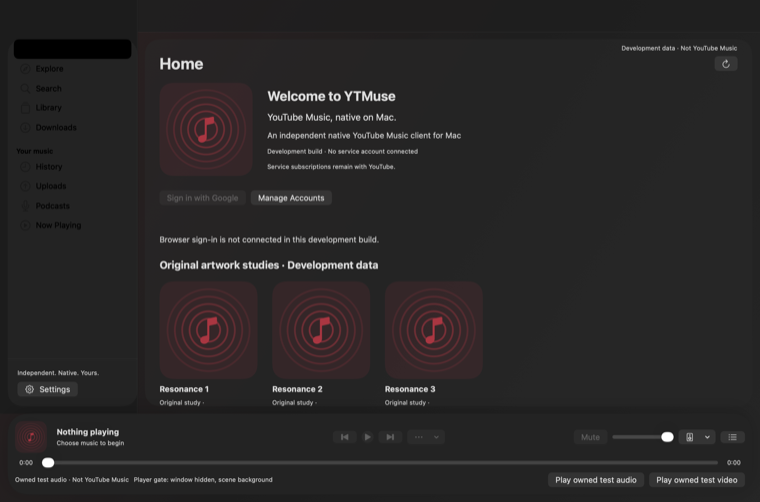

# YTMuse for macOS

*YouTube Music, native on Mac.* An independent, native SwiftUI/AppKit music client, **under development, with a public development preview**. It is not endorsed by, affiliated with or sponsored by Google, YouTube or Apple; "YouTube" and "YouTube Music" belong to Google, and this project uses neither company's logos. Original code is MIT licensed ([LICENSE](LICENSE)); third-party material is listed in [THIRD_PARTY_NOTICES.md](THIRD_PARTY_NOTICES.md).



## Status, honestly

The [0.1.12 development preview](https://github.com/danielproj/ytmuse/releases/tag/v0.1.12) provides a Developer ID-signed, notarized DMG for **Apple Silicon Macs running macOS 27 or later**. The app and installer have stapled Apple tickets and passed signature and Gatekeeper checks on the packaging Mac. By hand, on the 0.1.3 preview, the maintainer checked a clean install and a real signed update; that update crashed the old app as it quit, which 0.1.4 fixes. On 2026-11-05 the account holder confirmed the remaining core checks work, including update restart after the fix. Wider G09 distribution checks remain deferred; see the [backlog](Docs/Backlog.md). The source is public; [GitHub release setup](Docs/GitHub-Releases.md) records the packaging and acceptance limits.

The core page/sidebar/player redesign has passed bounded visual checks. Native-account smoke checks cover sign-in restoration, Search, playlist creation/editing/addition/removal, mix/radio startup and upcoming-item selection. On 2026-11-05 the account holder confirmed the remaining core checks all work, including radio filters, audible playback, media keys, cold launch and update restart. The agreed working core is accepted; [the refreshed backlog](Docs/Backlog.md) tracks the features requested since then and deferred work. This confirmation does not close the full account, accessibility, hardware or distribution matrices below.

**Fixed in the 0.1.12 preview:**
- Shuffle, Repeat and Dislike work for a signed-in account, which YouTube Music serves a different player (in 0.1.11 they were still greyed out).

**Fixed in the 0.1.11 preview:**
- Like and Dislike in the player read the rating the YouTube Music player shows for the playing song (in 0.1.10 they were greyed out for every song), and Shuffle and Repeat follow YouTube Music's changed player again.

**New in the 0.1.10 preview:**
- Like and Dislike for the playing song in the player bar, the expanded player, full screen and the mini-player, for any song including those from mixes, radio and the queue. Disliking the playing song skips to the next one.

**New in the 0.1.9 preview:**
- One design across the app in both styles, following Apple's macOS 27 guidance:
  - pages run edge to edge on a solid background;
  - the queue and lyrics panel is one side column;
  - buttons follow the standard Mac roles;
  - rows, cards, chips and messages look the same everywhere;
  - Settings uses the native sidebar.

**New in the 0.1.8 preview:**
- Settings › Appearance › Style: **Standard** (the macOS look, now the default: the main window lets the desktop show through, with plain Liquid Glass panels) or **YTMuse** (the app's own near-black look with the red accent). Both use the native macOS 27 sidebar with no panel behind the items.

**New in the 0.1.7 preview:**
- History scrolls smoothly: only the rows on screen are built, and the next page of your history is read only when you reach the end of the list.
- Share for the song that is playing is a button next to Queue in the player, instead of an item in the ⋯ menu.

**New in the 0.1.6 preview:**
- Share and Copy Link on songs, videos, albums, artists, playlists and Now Playing.
- Reading a song's comments on explicit request, with the service's sort orders, more pages and replies. Posting and moderating are not available.
- A Recap screen that shows the service's own message and error states. Recap summary figures are not implemented, because no successful Recap response has been captured.

These have automated tests only. The live share sheet, signed-in comments, scrolling a long signed-in history, layout and VoiceOver are unchecked. The [backlog](Docs/Backlog.md) has details. The release gates remain:

| Gate | State |
| --- | --- |
| G01 Authentication (real free and Premium sessions) | **open** — a signed-in session and restoration passed a bounded native-account check; the complete free/Premium and fresh-sign-in matrix remains unverified |
| G02 Native media access, G03 free-account playback, G04 Premium quality | **open** — playback of YouTube Music goes through the user-approved hidden system-WebKit player; native media access is not established |
| G05 Offline | **open** — YouTube Music offers no downloads to this app; only music from files on this Mac can be stored |
| G06 Service parity, G07 Casting, G08 System integration, G09 Distribution | **open** — see the [capability matrix](Docs/Capability-Matrix.md) |

Automated tests use **sanitized fixtures and owned synthetic audio**, isolated from real account stores. Separate, bounded manual checks use the installed app's normal interface. [Docs/Capability-Matrix.md](Docs/Capability-Matrix.md) records the wider implementation and acceptance limits. Upload functionality has been removed. The full contract is [the specification](Docs/Product-Specification.md).

## Install the preview

Download `YTMuse-0.1.12.dmg` from the [release page](https://github.com/danielproj/ytmuse/releases/tag/v0.1.12), open it, and drag **YTMuse.app** into **Applications**. Intel Macs and earlier macOS versions are not supported. The public build uses dedicated production app/widget identifiers and an application group; it does not include a migration from development stores. Automatic update checks require opt-in, and installing an update requires an explicit restart.

## Build from source

You need an Apple Silicon Mac on macOS 27 or later with Xcode 27.2 (build 27B52) selected. No account, signing identity, certificate, private file or secret is needed. The toolchain is pinned in [toolchain.json](toolchain.json) and checked by this command, which fails on any other version:

```sh run
./scripts/check-toolchain.sh
```

Build and run the app locally, then run a test suite (details and the other suites in [Docs/Build.md](Docs/Build.md)):

```sh
./scripts/build.sh
open .build/xcode/Build/Products/Release/YTMuse.app
./scripts/test.sh --suite T02
```

A source build is signed ad hoc, so it has **no update feed and never contacts an update server**. To check the module boundaries and the dependency, licence and SBOM rules without building the app:

```sh run
python3 scripts/check-boundaries.py
python3 scripts/check-distribution.py --source-only
```

To prove a fresh clone builds and tests with no secrets (it clones under `~/Projects`, runs the same steps as CI and deletes the clone): `./scripts/clean-checkout.sh`.

## Documentation

| | |
| --- | --- |
| [CONTRIBUTING.md](CONTRIBUTING.md) | how to build, test and propose changes |
| [SECURITY.md](SECURITY.md) | reporting a vulnerability, and what is protected |
| [PRIVACY.md](PRIVACY.md) | what the app stores and sends |
| [Docs/Distribution.md](Docs/Distribution.md) | releases, the updater, signing, the App Store question |
| [Docs/Backlog.md](Docs/Backlog.md) | accepted core and deferred work |
| [Docs/Capability-Matrix.md](Docs/Capability-Matrix.md) | what works, what is fixture-tested, what is not built |
| [Docs/Publishing-Checklist.md](Docs/Publishing-Checklist.md) | publishing checks and remaining distribution acceptance |
| [Docs/Architecture.md](Docs/Architecture.md), [Docs/Build.md](Docs/Build.md) | structure, modules and the local toolchain |

## Independence

YTMuse is a client written by its contributors for people who already use YouTube Music. It does not proxy, resell or relay any media, keeps all state on the Mac, and never asks you to copy cookies out of a browser. Subscriptions and content remain YouTube's. Anything the service does not allow a third-party client to do is reported as such in the app rather than imitated.
